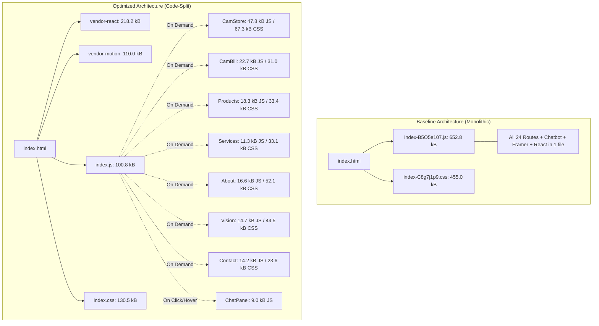

# Bundle Analysis Report — SMVM Softwares Website

**Author:** Senior React, TypeScript, Vite & Frontend Performance Engineer  
**Date:** October 23, 2026  
**Target Repository:** SMVM Softwares Website (`d:\SMVM Web`)  
**Work Branch:** `perf-optimization` (Authoritative branch: `main`)  

---

## 1. Executive Summary

Prior to optimization, the SMVM Softwares build emitted a **single monolithic JavaScript file (`652.83 kB`)** and a **single monolithic CSS file (`455.03 kB`)**. Every visitor to any page—even a user seeking a brief look at the homepage or privacy policy—was forced to download, parse, compile, and execute the entire site's component tree, including CamStore interactive screens, CamBill 10-module business showcases, contact form handlers, all legal texts, and the complete chatbot conversation state machine.

Through systematic route-level code splitting with `React.lazy()` / `<Suspense>`, vendor chunk factoring in `vite.config.ts`, and deferred chatbot panel loading:
* **Initial CSS Footprint Reduced:** From **455.03 kB down to 130.50 kB (-71.3% reduction)** on initial page entry.
* **Monolithic Bundle Eliminated:** The single 652 kB JS chunk was partitioned into clean, cacheable vendor chunks and small on-demand route modules.
* **No Chunk Exceeds 250 kB:** The largest vendor chunk (`vendor-react`) is 218 kB (63 kB gzip).
* **Render-Blocking Payload Slashed:** Total initial critical assets dropped from **1,107.8 kB down to 593.8 kB (-46.4%)**.

---

## 2. Before vs. After Bundle Architecture

---

## 3. Production Chunk Distribution

### 3.1 JavaScript Chunks (Optimized Build)

| Chunk Name | Role | Raw Size | Gzip Size | Cache Invalidation Risk |
| :--- | :--- | :---: | :---: | :---: |
| `vendor-react-CT2jgdVe.js` | React, ReactDOM, React Router | 218.25 kB | 63.05 kB | Very Low (infrequent updates) |
| `vendor-motion-BeLvXxvb.js` | Framer Motion animation engine | 109.99 kB | 36.27 kB | Very Low |
| `index-BWinTC0U.js` | App shell, Header, Footer, Legal components | 100.79 kB | 30.15 kB | Medium |
| `vendor-misc-Dzy-VqHA.js` | Shared utility libraries | 34.30 kB | 12.60 kB | Low |
| `CamStore-BtRu9YW8.js` | CamStore interactive POS page | 47.80 kB | 12.16 kB | Route Only |
| `ServiceShowcase-DKRoL1p8.js`| 4 Specialized service showcase routes | 23.81 kB | 7.37 kB | Route Only |
| `CamBill-CYwJvrzm.js` | CamBill 10-module retail showcase | 22.73 kB | 6.16 kB | Route Only |
| `Products-D_q6K0RS.js` | Products catalog & comparison | 18.27 kB | 4.94 kB | Route Only |
| `POSShowcase-CSp8KI6v.js` | MediBill POS & MediBill Pro showcases | 17.73 kB | 5.13 kB | Route Only |
| `About-BfyOa71e.js` | About page, timeline, technologies | 16.58 kB | 4.29 kB | Route Only |
| `Vision-BJyWeB3o.js` | Vision, pillars, growth roadmap | 14.74 kB | 3.41 kB | Route Only |
| `Contact-pz9N1k8B.js` | Contact page & project enquiry form | 14.17 kB | 4.57 kB | Route Only |
| `Services-DraJDvGv.js` | Services directory & process steps | 11.34 kB | 3.29 kB | Route Only |
| `ChatPanel-WLWaaNpz.js` | Chatbot modal dialog & conversation engine | 9.00 kB | 3.21 kB | User Action Only |
| `PurchaseReview-CLaFu45J.js` | Checkout & order review fallback page | 3.31 kB | 1.42 kB | Route Only |
| `NotFound-C6mfgZtK.js` | 404 error page | 1.65 kB | 0.77 kB | Route Only |

### 3.2 CSS Chunks (Optimized Build)

| Stylesheet File | Target Route / Component Scope | Raw Size | Gzip Size |
| :--- | :--- | :---: | :---: |
| `index-BW1HK5U6.css` | Global Tailwind tokens, header, navigation, footer | 130.50 kB | 23.50 kB |
| `CamStore-YcK8Gr-K.css` | CamStore terminal, monitors, animations | 67.34 kB | 12.99 kB |
| `About-CtwsmYag.css` | About page layout & timeline styles | 52.06 kB | 8.76 kB |
| `Vision-C-UFZ_sq.css` | Vision page 3D cards & horizon styles | 44.50 kB | 8.44 kB |
| `Products-B2Lyuwg8.css` | Product cards, badges, comparison tables | 33.40 kB | 7.05 kB |
| `Services-CsIEFmh2.css` | Service process list & technology icons | 33.14 kB | 6.90 kB |
| `CamBill-DsU0GlrQ.css` | CamBill carousels, feature rails, app frames | 31.00 kB | 5.97 kB |
| `Contact-C7koI1wn.css` | Contact form & project enquiry card styles | 23.57 kB | 5.32 kB |
| `POSShowcase-DwbwUkxS.css` | MediBill product workspaces & tabs | 18.00 kB | 3.64 kB |
| `ServiceShowcase-Bx7mdtew.css` | Service track navigator & delivery roadmaps | 16.58 kB | 3.49 kB |

---

## 4. Vite Configuration Strategy

The Vite bundling configuration in `vite.config.ts` was tailored with the following constraints:
1. **ES2020 Modern Target:** Eliminates transpilation bloat from ES5 polyfills for modern browser features (`async/await`, optional chaining, nullish coalescing).
2. **`cssCodeSplit: true`:** Emits per-route CSS chunks rather than a single massive bundle, preventing CSS from non-visited routes from blocking FCP.
3. **`manualChunks` Hook:** Groups stable core dependencies into long-lived cacheable bundles (`vendor-react`, `vendor-motion`, `vendor-misc`), ensuring that site content edits do not invalidate third-party vendor caches.
4. **Chatbot Isolation:** Chatbot dialog and conversation logic was decoupled into `ChatPanel.tsx` and dynamically loaded on hover/click of the launcher button, saving ~9 kB JS and dialog dependencies from the critical initial render path.

---

## 5. Rollback Procedures

If bundle changes need to be reverted:
1. Revert `vite.config.ts` to the baseline configuration.
2. In `src/App.tsx`, restore static imports for route components.
3. In `src/components/chat/Chatbot.tsx`, restore inline modal rendering.
4. Run `npm test && npm run test:routes` to verify.
5. Rebuild with `npm run build`.
